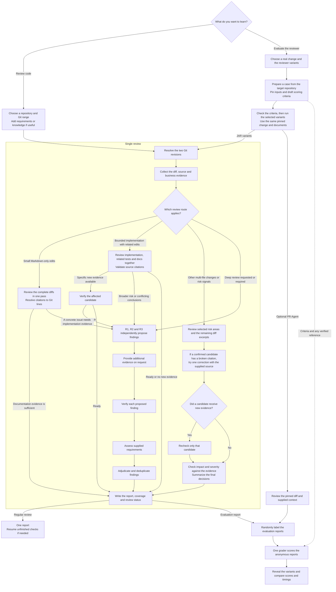

# repo-aware-reviewer

[简体中文](README.zh-CN.md)

Review committed Git changes through your local Claude Code setup, with optional requirements and a human-approved business knowledge base. Reports describe static findings supported by code evidence.

## First use

### 1. Prepare the CLI

Install Java 21 or later, Git and Bash, and have a working, configured `claude` command. The project to review must be available locally, including the target commit and its parent.

For a published version, download `code-review-agent.jar` from [Releases](https://github.com/graham-gc/repo-aware-reviewer/releases) and substitute its path in the examples below. To build from source, use JDK 21 or later.

```bash
git clone https://github.com/graham-gc/repo-aware-reviewer.git
cd repo-aware-reviewer
bash scripts/build.sh
```

Check your Claude Code setup before your first review.

```bash
printf '%s\n' 'Reply with OK.' | claude -p
```

Once the check returns `OK`, the CLI can reuse your local Claude Code authentication and model routing; no separate API key setup is required. If you already have this tool's checkout, enter its directory and build it.

The examples below assume you built the JAR from source and are running from this tool's project directory. `/path/to/project` refers to the project being reviewed. Replace example paths and `abc1234`. When running elsewhere, use an absolute JAR path.

### 2. Run your first code review

```bash
java -jar build/code-review-agent.jar review \
  --repo /path/to/project \
  --language en
```

This minimal command reviews **`HEAD` against its first parent**. It does not review uncommitted changes, fetch remote code, or automatically generate or load a business knowledge base. Without a supplied requirements document, it does not perform external requirement-by-requirement acceptance assessment.

Reviews are static: the tool does not run the target project's build or tests. English is the default output language; use `--language zh-CN` for Simplified Chinese or `--language en` for English. This option selects the report language, not a programming language.

The command prints its run directory. Open `report.md` and check `review-status.md`. You can review code immediately; for business review without an existing approved knowledge base, start with scenario 1 below.

## Workflow

Use a regular review to find defects in a project change. Use a blind evaluation when deciding whether a change to the reviewer improves the quality of its reports.



## Common scenarios

### 1. Onboard a project: generate a candidate business knowledge base

```bash
java -jar build/code-review-agent.jar knowledge generate \
  --repo /path/to/project \
  --ref HEAD \
  --language en
```

Inventory tracked files at local `HEAD` and analyze supported text in chunks to produce `candidate-knowledge.md`. The run directory defaults to `knowledge-output/`. Omitting `--ref` also selects `HEAD`.

Review and correct the candidate, save an approved knowledge file, then pass it through `--knowledge`. A candidate is never automatically approved. Skip this step if you already maintain a knowledge base.

### 2. Review a specific commit against requirements and approved knowledge

```bash
java -jar build/code-review-agent.jar review \
  --repo /path/to/project \
  --commit abc1234 \
  --requirement /path/to/review-docs/requirement.md \
  --knowledge /path/to/review-docs/knowledge.md \
  --knowledge-mode scoped \
  --language en
```

Compare `abc1234` with its first parent and assess the supplied requirements. `--knowledge` takes one human-approved UTF-8 Markdown file; `--requirement` takes a separate UTF-8 requirements file. Both use explicit paths, are optional independently, and can live outside the reviewed repository.

For code review alone, omit `--requirement`, `--knowledge`, and `--knowledge-mode`. You can also supply just requirements or just knowledge. `--knowledge-mode scoped` requires `--knowledge` and loads relevant sections; without that mode, the whole knowledge document is supplied. Omitting `--commit` selects `HEAD`.

### 3. Compare two local revisions

```bash
java -jar build/code-review-agent.jar review \
  --repo /path/to/project \
  --branch HEAD \
  --base main \
  --language en
```

Directly compare local `main` and `HEAD` snapshots, equivalent to `git diff main HEAD`. Replace `HEAD` with a development branch or commit ID and `main` with another locally available baseline. This does not update local `main`.

### 4. Compare against the latest remote baseline

```bash
java -jar build/code-review-agent.jar review \
  --repo /path/to/project \
  --branch HEAD \
  --base main \
  --base-remote origin \
  --language en
```

Fetch remote `main` from the configured `origin`, then directly compare it with local `HEAD`. The target revision must already exist locally. Fetch uses the repository's existing Git authentication; this tool does not require a separate Git token parameter.

Another baseline can be selected with `--base release/1.0`. With `--base-remote`, use the remote branch name `main`, not `origin/main`. `--branch` and `--base` must be supplied together and cannot be combined with `--commit`. Add the document options from scenario 2 for business checks.

### 5. Resume an interrupted or incomplete review

This example resumes the minimal command from first use:

```bash
java -jar build/code-review-agent.jar review \
  --repo /path/to/project \
  --language en \
  --resume /path/to/previous-run \
  --review-parallelism 1
```

Replace `/path/to/previous-run` with the earlier run directory. Preserve any commit, branch, baseline, requirements, knowledge and other input settings from the original command. Keep the resolved target commit, document contents and evidence settings unchanged; if the original command used `HEAD`, it must still point to that commit. Saved tasks are revalidated; valid matches are reused, while invalid, missing or changed prompts continue.

Concurrency can change: `--review-parallelism 1` runs independent reviewers sequentially; the default remains `3`. Resume reuses the pinned remote baseline without fetching again. Start a new review to fetch a newer baseline.

### 6. Inspect scope and evidence without calling a model

```bash
java -jar build/code-review-agent.jar review \
  --repo /path/to/project \
  --commit abc1234 \
  --language en \
  --prepare-only
```

Save the scope, evidence and prompts without producing a final review verdict. `knowledge generate` also accepts `--prepare-only`.

## Results and common settings

Default output roots are relative to the **terminal's current working directory**: `review-output/` for reviews and `knowledge-output/` for candidate knowledge. Add `--output-dir /path/to/output` to change the location.

- `report.md`: findings and acceptance assessment; `review-status.md`: whether the review finished.
- `scope.md`: the actual compared commits; `coverage.md`: evidence gaps and verification coverage.
- `timings.md`: current execution calls, input bytes, stage wall time and cache reuse.
- `candidate-knowledge.md`: a draft for human review, not approved rules.

The report's Findings section separates confirmed defects, risks requiring human review, and unfinished checks. A completed review can still contain review-required items; their full evidence and decisions remain in `coverage.md`.

| Exit code | Meaning |
| --- | --- |
| `0` | Output completed, prepared only, or skipped for an empty diff; not code approval. |
| `3` | Review incomplete; inspect the report and use `--resume`. |
| `1` | Execution failed; check the terminal error and invocation logs. |
| `2` | Invalid command arguments. |

Each model call defaults to a 900-second timeout, configurable with `--agent-timeout-seconds`. Empty responses and recognized temporary errors allow at most one extra retry by default when observed process cleanup is verified; disable this with `--agent-retries 0`. Unfinished checks are distinct from business evidence gaps. Completed review does not establish that all requirements are satisfied or that tests actually ran and passed.

Review defaults to `--review-mode auto`. Small source changes with complete evidence can finish in one model call. One bounded implementation edit can enter the same route with its directly related test or documentation diffs. For example, a test in the matching module can qualify by following a naming convention or referencing the implementation in its added lines. A document can qualify by pointing to the implementation path. The local review can escalate if it identifies a broader effect.

A grouped local review starts with complete diffs and nearby implementation lines at both revisions. It can request another tracked excerpt to resolve an individual finding.

A small change limited to existing Markdown READMEs or files under `docs/` can also finish in one call. The CLI resolves cited lines to the pinned Git revision and lists model observations for human review. A specific issue that needs implementation or contract evidence can trigger deep review.

For other multi-file changes or detected risk signals, the CLI gives related files and more source context to a scoped risk check, and reviews the remaining files with bounded diff excerpts. A scoped candidate can receive one citation correction using available source. The CLI rechecks a candidate's conclusion when it receives new evidence. The scoped report summarizes the final decisions. A confirmed finding needs target evidence for its stated impact, and high or critical severity also needs evidence of the material effect or affected scope. See `coverage.md` for evidence gaps and publishing decisions. Supplied review rules and explicit `--review-mode deep` use the full workflow.

When explicit Python sibling imports link changed durable state to a changed external-effect caller, the scoped request groups those implementations and their identified dependencies for the recovery check. Other changed code stays in scope. For verified additions in that request, the new-file diff header establishes attribution and complete target source supplies the added lines. Scopes without a recognized link use the regular file grouping.

Diff hunks omitted from the first scoped requests share one bounded follow-up. If any hunks still do not fit, the report lists the unreviewed ranges and returns exit code 3. Risk checks can include a small amount of unchanged Python code linked by explicit sibling imports. Confirmed scoped candidates rated medium or higher, or supported by a premise in another target file, receive independent verification before publication.

Deep candidate verification uses relevant complete evidence blocks by default. To compare evidence modes, use `--review-mode deep` on both sides and add `--verification-evidence full` on the full-input side.

Review-required findings can include a suggested check for the maintainer, covering the missing premise, a concrete action, and the observation that would resolve it. The CLI performs static review.

To compare model assignments, pass `--discovery-model` three times in R1, R2, R3 order, for example `--discovery-model sonnet --discovery-model opus --discovery-model haiku`. These models apply to the three initial reviewers, including their retries and corrections. Resume with the same assignments.

## Blind evaluation

An evaluation case is one committed change from any local Git repository, together with the criteria a grader uses to assess the reports. This example asks whether a reviewer finds missing database migrations. Python 3.11+ is required for the evaluation script.

```bash
python3 scripts/review-eval.py prepare \
  --repo /path/to/project --base main --head HEAD \
  --focus "Check whether the review detects missing database migrations" \
  --language en --output outputs/eval-case-01
```

Review the draft criteria in `outputs/eval-case-01/cases.json`. You can pass `--requirement` or `--knowledge` during preparation to include snapshots of those documents in both reviews. Pass `--reference /path/to/verified-findings.md` when you have verified findings for the grader. Without a reference, the tool marks the missed-defect count `N/A`. The grader can still compare how many criteria each report meets.

```bash
python3 scripts/review-eval.py run \
  --cases outputs/eval-case-01/cases.json \
  --baseline-jar /path/to/older.jar \
  --candidate-jar build/code-review-agent.jar \
  --language en --output outputs/eval-run-01
```

Add `--pr-agent pr-agent` to include a configured PR-Agent CLI as a third variant. Give the grader the anonymous reports and criteria in `outputs/eval-run-01/blind/`, plus access to the pinned change. After the grader fills in `blind/grades.csv`, reveal and summarize the results with `python3 scripts/review-eval.py summarize --output outputs/eval-run-01`. [Scoring and experiment options](docs/review-performance.md#blind-review-evaluation)

## Contributing

Open a pull request against `main`. CI runs the Java, GitLab integration and blind evaluation tests. Use public fixtures or sanitized samples when sharing review cases and logs. Keep internal knowledge bases and project-specific review reports outside this public repository.

Maintainers can push a version tag such as `v0.1.0` on a commit in `main` history. After CI passes, GitHub Actions prepares a release draft with the JAR and its SHA-256 checksum for maintainer review and publication.

## Further reading

- [GitLab CI/CD: automatic MR reviews and `/review` comments](docs/gitlab-integration.md)
- [Verification performance and comparison](docs/review-performance.md)
- [Runtime failures, retries, budgets and resume](docs/runtime-reliability.md)
- [Language coverage and dependency reading](docs/language-modules.md)
- [GitHub Actions integration example](examples/github-review.yml)
