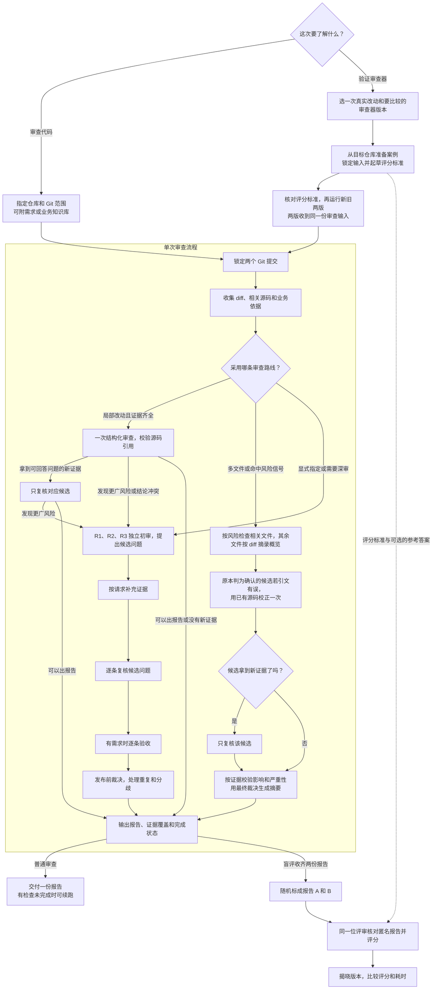

# repo-aware-reviewer

[English](README.md)

通过本机 Claude Code 审查 Git 提交，可结合需求文档和人工确认的业务知识库，生成有代码证据的静态审查报告。

## 首次使用

### 1. 准备 CLI

需要 Java 21 或以上版本、Git、Bash，以及已经配置好、能正常运行的 `claude` 命令。目标项目须在本地，包含要审查的提交及其父提交。

要使用正式版本，从 [Releases](https://github.com/graham-gc/repo-aware-reviewer/releases) 下载 `code-review-agent.jar`，并将下方示例中的 JAR 路径替换为下载位置。从源码构建需要 JDK 21 或以上版本。

```bash
git clone https://github.com/graham-gc/repo-aware-reviewer.git
cd repo-aware-reviewer
bash scripts/build.sh
```

首次审查前，检查 Claude Code 是否可用。

```bash
printf '%s\n' '只回复 OK' | claude -p
```

返回 `OK` 后即可使用。本工具复用本机 Claude Code 的认证和模型路由，无需另行配置 API Key。已有本工具代码时，直接进入其目录构建即可。

下方示例以从源码构建并在本工具项目目录执行为例。`/path/to/project` 是被审查项目。请替换示例路径和 `abc1234`。从其他目录调用时，将 JAR 路径改为绝对路径。

### 2. 完成第一次代码审查

```bash
java -jar build/code-review-agent.jar review \
  --repo /path/to/project \
  --language zh-CN
```

这条最小命令会审查 **`HEAD` 相对第一父提交的改动**，生成中文报告。它不审查未提交改动，不自动拉取远端代码，也不自动生成或加载主知识库。没有传入需求文档时，不做针对外部需求的逐条验收。

所有审查均为静态阅读，不执行目标项目的构建或测试。报告默认语言是英语；`--language zh-CN` 指定中文，`--language en` 指定英语。该参数选择报告语言，不是编程语言。

运行结束后，终端输出本次目录。打开其中的 `report.md`，并检查 `review-status.md`。第一次运行即可做代码审查；需要业务审查但还没有主知识库时，先使用下面的场景 1。

## 工作流程

要找一次代码改动里的问题，走普通审查。要判断新版审查器的报告是否更准确，走盲评，用同一次改动对照新旧两版。



## 常见使用场景

### 1. 新项目：生成候选业务知识库

```bash
java -jar build/code-review-agent.jar knowledge generate \
  --repo /path/to/project \
  --ref HEAD \
  --language zh-CN
```

扫描本地 `HEAD` 中的已跟踪文件，对支持的文本分块分析，生成 `candidate-knowledge.md`。默认输出到 `knowledge-output/` 下的本次目录；省略 `--ref` 也默认扫描 `HEAD`。

人工核对、修正候选稿后，另存为主知识库，再通过 `--knowledge` 传入。候选稿不会自动成为主知识库；已有人工知识库时可跳过这一步。

### 2. 指定提交：结合需求和主知识库审查

```bash
java -jar build/code-review-agent.jar review \
  --repo /path/to/project \
  --commit abc1234 \
  --requirement /path/to/review-docs/requirement.md \
  --knowledge /path/to/review-docs/knowledge.md \
  --knowledge-mode scoped \
  --language zh-CN
```

比较 `abc1234` 与其第一父提交，并针对需求逐项评估。`--knowledge` 接收一份人工确认的 UTF-8 Markdown，`--requirement` 接收独立的 UTF-8 需求文件；两者都使用显式路径，互不依赖，也不要求放在被审查仓库内。

只审代码时，去掉 `--requirement`、`--knowledge` 和 `--knowledge-mode`。只用需求或只用知识库也可以；`--knowledge-mode scoped` 必须配合 `--knowledge`，表示按需读取相关章节，省略此参数则默认传入整份知识库。省略 `--commit` 则审查 `HEAD`。

### 3. 比较两个本地版本

```bash
java -jar build/code-review-agent.jar review \
  --repo /path/to/project \
  --branch HEAD \
  --base main \
  --language zh-CN
```

直接比较本地 `main` 与 `HEAD` 的快照，等同于 `git diff main HEAD`。可以将 `HEAD` 换成开发分支名或提交 ID，将 `main` 换成其他本地可用基线。它不会自动更新本地 `main`。

### 4. 与远端最新基线比较

```bash
java -jar build/code-review-agent.jar review \
  --repo /path/to/project \
  --branch HEAD \
  --base main \
  --base-remote origin \
  --language zh-CN
```

先从已配置的 `origin` 获取远端 `main`，再直接与本地 `HEAD` 比较。目标版本必须已在本地；获取使用仓库已有的 Git 认证，不需要给本工具单独传 Git Token。

基线也可改为 `--base release/1.0`。启用 `--base-remote` 时写远端分支名 `main`，不写 `origin/main`。`--branch` 与 `--base` 必须成对使用，不能与 `--commit` 混用。需要业务校验时，可追加场景 2 的需求和知识库参数。

### 5. 续跑中断或未完成的审查

下例对应首次使用的最小命令：

```bash
java -jar build/code-review-agent.jar review \
  --repo /path/to/project \
  --language zh-CN \
  --resume /path/to/previous-run \
  --review-parallelism 1
```

将 `/path/to/previous-run` 替换为此前终端输出的运行目录。原命令如果指定了提交、分支、基线、需求或知识库，续跑时须保留相同参数和值。目标提交、文档内容和证据设置也须与原运行一致；原来使用 `HEAD` 时，`HEAD` 必须仍指向原提交。程序重新校验并复用有效任务，继续无效、缺失或提示词已变化的任务。

并发可以调整；`--review-parallelism 1` 让独立审查者依次执行，默认值仍是 `3`。远端基线在续跑时复用原快照，不重新获取；要比较更新后的远端基线，请开启新审查。

### 6. 先检查范围和证据，不调用模型

```bash
java -jar build/code-review-agent.jar review \
  --repo /path/to/project \
  --commit abc1234 \
  --language zh-CN \
  --prepare-only
```

只保存审查范围、证据和提示词，不生成最终审查结论。`knowledge generate` 也支持 `--prepare-only`。

## 结果与常用设置

输出目录默认位于**执行命令时的当前工作目录**下：`review-output/` 保存审查，`knowledge-output/` 保存候选知识库。追加 `--output-dir /path/to/output` 可以更改。

- `report.md`：审查报告；`review-status.md`：本轮是否审完。
- `scope.md`：实际比较的提交；`coverage.md`：证据缺口和复核情况。
- `timings.md`：本次调用次数、输入大小、阶段实际耗时和复用情况。
- `candidate-knowledge.md`：供人工核对的候选知识库，不是已批准规则。

报告的“问题发现”会分别列出已确认缺陷、需人工确认的风险和未完成检查。审查执行完成后仍可能存在待确认事项，完整证据及裁决保留在 `coverage.md`。

证据不足时，报告可附上「建议核对步骤」，说明仍缺哪个前提、维护者可以怎么查，以及哪种结果能解开疑问。步骤由维护者执行，审查程序只做静态分析。

| 退出码 | 含义 |
| --- | --- |
| `0` | 输出已完成、仅准备完成，或空 diff 已跳过；不代表代码验收通过。 |
| `3` | 审查未完成，查看报告后用 `--resume` 补齐。 |
| `1` | 执行失败，查看终端错误及调用日志。 |
| `2` | 命令参数错误。 |

模型调用默认超时为 900 秒，可用 `--agent-timeout-seconds` 调整。空响应和明确的临时错误在可验证进程清理后，默认最多额外重试一次；用 `--agent-retries 0` 关闭。检查未完成与业务证据不足会分别标明；审查完成不代表需求全部满足或测试实际运行通过。

审查默认使用 `--review-mode auto`。证据齐全的小改动可通过一次模型调用完成。多文件改动或命中风险信号时，CLI 对相关文件做定向检查，并通过有界的 diff 摘录审查其余文件。分区审核中，引用有误的候选可用已有源码校正一次。候选获得新证据时，CLI 会针对该候选复核结论。分区报告根据最终裁决生成摘要。已确认缺陷需要目标版本的证据支持所述影响，评为高或严重还需要实际损失、暴露或影响范围的证据。`coverage.md` 记录证据缺口和发布裁决。提供审查规则或显式使用 `--review-mode deep` 时走完整深审。

深审的候选复核默认按相关完整证据块提供上下文。对照输入量和质量时，两边都用 `--review-mode deep`，全量输入的一边再加 `--verification-evidence full`。

多模型初审可用于对照实验。在 `review` 命令上按 R1、R2、R3 的顺序传三次 `--discovery-model`，例如 `--discovery-model sonnet --discovery-model opus --discovery-model haiku`。仅这三个初审任务及其重试和纠错使用指定模型，续跑需保留同一顺序和模型。

## 盲评审查器

一个盲评案例就是任意本地 Git 仓库里的一次已提交改动，以及评审者用来核对报告的评分标准。下面以「新版能否发现遗漏的数据库迁移」为例。盲评脚本需要 Python 3.11 或以上版本。

```bash
python3 scripts/review-eval.py prepare \
  --repo /path/to/project --base main --head HEAD \
  --focus "检查审查报告是否能发现遗漏的数据库迁移" \
  --language zh-CN --output outputs/eval-case-01
```

在 `outputs/eval-case-01/cases.json` 里核对评分草稿。准备时可以用 `--requirement` 或 `--knowledge` 保存文档快照，供两版审查器共用。已有核实过的缺陷时，可用 `--reference /path/to/verified-findings.md` 提供给评审者。没有参考答案时，漏报记为 `N/A`，仍可比较两份报告各有多少条评分标准未达到。

```bash
python3 scripts/review-eval.py run \
  --cases outputs/eval-case-01/cases.json \
  --baseline-jar /path/to/older.jar \
  --candidate-jar build/code-review-agent.jar \
  --language zh-CN --output outputs/eval-run-01
```

将 `outputs/eval-run-01/blind/` 里的两份报告和评分标准交给同一位评审者，并让其能核对固定的代码改动。填完 `blind/grades.csv` 后，运行 `python3 scripts/review-eval.py summarize --output outputs/eval-run-01` 揭晓版本并汇总。 [评分和对照选项](docs/review-performance.md#blind-review-evaluation)

## 参与贡献

向 `main` 提交 PR。CI 会运行 Java、GitLab 集成和盲评测试。分享审查案例和日志时，使用公开测试数据或脱敏样例。内部知识库和真实项目的审查报告保存在公开仓库之外。

维护者可以在 `main` 历史中的提交上推送版本标签，例如 `v0.1.0`。CI 通过后，GitHub Actions 会生成附带 JAR 和 SHA-256 校验文件的发布草稿，由维护者核对后发布。

## 进一步阅读

- [GitLab CI/CD：MR 自动审查与 `/review` 评论触发](docs/gitlab-integration.zh-CN.md)
- [候选复核性能与对照方法](docs/review-performance.md)
- [运行失败、重试、预算与续跑](docs/runtime-reliability.md)
- [语言支持范围与依赖读取](docs/language-modules.md)
- [GitHub Actions 接入示例](examples/github-review.yml)
